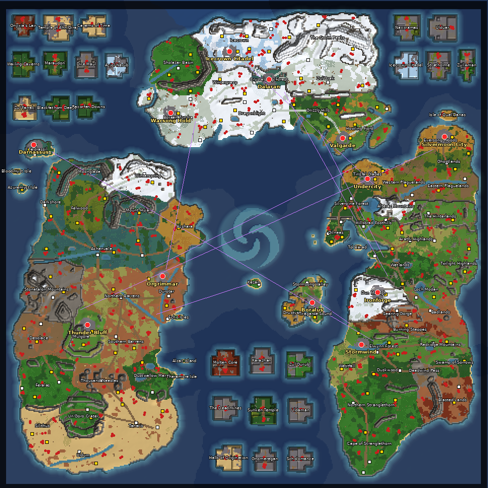

# Azeroth for Warcraft III

**[`dist/(12)Azeroth.w3x`](dist/(12)Azeroth.w3x)** is a 12-player melee map of the whole world of Azeroth. It is built at **480 × 480 tiles**, the largest size Warcraft III supports. The playable area is 468 × 468 tiles, about 60,000 × 60,000 world units.



*Overview render: capitals in red, gold mines in yellow, shops and waygates in white, creep camps as red dots, portal links between the continents in purple (the instance waygates are left unlinked to keep it readable). Cliff edges are drawn dark.*

## What's on the map

| Landmass | Zones |
|---|---|
| **Kalimdor** | Teldrassil, Darkshore, Moonglade, Felwood, Winterspring, Mount Hyjal, Azshara, Ashenvale, Stonetalon, the Barrens, Durotar, Desolace, Mulgore, Feralas, Thousand Needles, Dustwallow Marsh, Un'Goro Crater, Tanaris, Silithus, Uldum, plus Azuremyst, Bloodmyst, the Echo Isles and Theramore |
| **Eastern Kingdoms** | Quel'Danas, Eversong, Ghostlands, Tirisfal, both Plaguelands, Silverpine, Gilneas, Hillsbrad, Alterac, the Hinterlands, Arathi, Wetlands, Twilight Highlands, Dun Morogh, Loch Modan, Badlands, Searing Gorge, Burning Steppes, Redridge, Elwynn, Westfall, Duskwood, Deadwind Pass, Swamp of Sorrows, Blasted Lands, Stranglethorn. Gilneas is a compact peninsula continuing Lordaeron's west coast south of Silverpine, as on the City-States of Arathor map. The ring of Gilneas City sits by a harbour on its east side, two islets lie off its west coast, and the Greymane Wall seals it off from Silverpine. Tol Barad sits out in Baradin Bay to the south-east |
| **Northrend** | Follows the Wrath of the Lich King continent map across the top of the map: Borean Tundra and Howling Fjord as the southern lobes with Dragonblight's bay between them, Coldarra off Borean, Sholazar Basin, Wintergrasp, Icecrown, Crystalsong Forest, the Storm Peaks, Zul'Drak, the Grizzly Hills with Venture Bay, and the fjords of Howling Fjord |
| **The Great Sea** | The Maelstrom (a whirlpool of spiral shallows round a bottomless eye), the goblin isle of Kezan, and Kul Tiras, traced from the Battle for Azeroth map: Stormsong Valley in the north, Drustvar's peaks to the south-west, and Tiragarde Sound with Boralus to the south-east, split by Boralus harbour, its strait and a western inlet |

| **Instances** | 24 dungeons and raids, each a walled, cliff-edged island in a corner of the sea, reached through a waygate from its entrance in the world. North-west: Onyxia's Lair, Temple of Ahn'Qiraj, Caverns of Time, Wailing Caverns, Maraudon, Dire Maul, Azjol-Nerub, Zul'Farrak, Blackfathom Deeps, Razorfen Downs. North-east: Naxxramas, Ulduar, Icecrown Citadel, Stratholme, Zul'Aman. South: Molten Core, Karazhan, Zul'Gurub, the Deadmines, Sunken Temple, Uldaman, Halls of Origination, Gnomeregan, Scholomance |

### The look

The terrain follows the style of the big hand-made WoW maps for Warcraft III, such as WoW Reanimated. Only the look was used as a reference; none of that map's terrain or objects were copied.

- **Cliff coastlines.** Shores are cliff walls rising out of a pale shelf of shallows. Beaches stay where units need to reach the water: along the wading straits and river mouths, at every shipyard, round the small islands, and on a few stretches of open coast.
- **Raised and sunken zones.** Highland zones stand one cliff level above their neighbours: Winterspring, Mount Hyjal, Stonetalon, Alterac, the Hinterlands, Dun Morogh, Searing Gorge, Icecrown, the Storm Peaks, Zul'Drak and Drustvar. Un'Goro Crater sinks one level below. Wherever a road crosses one of these edges it climbs a ramp, built the way the World Editor builds them.
- **Terraced mountains.** High ridges and peaks become stacked cliff terraces. Roads keep their passes open, and nothing that matters ends up on a cut-off plateau.
- **Instances.** Each dungeon has a vestibule round its waygate, a pillared hall, a guard camp halfway, and its boss on a raised dais at the far end, reached up a ramp. Floors are themed: lava cracks in Molten Core and Onyxia's Lair, sand and brick in the desert temples, brick and poison in the crypts, ice in the Northrend raids, and moss in the caverns.
- **Paved capitals** in Cityscape brick.

There are 93 zones in all, counting the instances. Each zone has its own ground textures, tree type, relief and creeps: jungle in Stranglethorn, blight in the Plaguelands, lava cracks in the Burning Steppes, cliff mesas in Thousand Needles and at Thunder Bluff, the crater rim around Un'Goro, and the Greymane Wall, a cliff rampart whose gate is the only way into Gilneas on foot. A few landmark doodads are placed too: the World Trees at Teldrassil and Hyjal, the Sunwell, the Frozen Throne, the ruins of Dalaran, the Dark Portal, and volcanoes at Blackrock and Un'Goro.

**Start locations** (one per player slot): Stormwind, Orgrimmar, Undercity, Darnassus, Ironforge, Thunder Bluff, Silvermoon City and Boralus, plus four in Northrend: Icecrown Citadel, Dalaran, Warsong Hold and Valgarde. Each one gets a 15,000-gold mine and a grove of trees for lumber.

**Getting between continents.** Nine pairs of mage portals (waygates) link the landmasses, and 24 more pairs lead into the instances. They sit about 17 tiles outside each capital, so no portal opens directly into a base:

- Stormwind ↔ Darnassus
- Orgrimmar ↔ Undercity
- Thunder Bluff ↔ Silvermoon
- Ironforge ↔ Dalaran
- Undercity ↔ Icecrown
- Orgrimmar ↔ Warsong Hold
- Menethil Harbor ↔ Valgarde
- Stormwind Harbor ↔ Boralus
- Ratchet ↔ Kezan

Goblin shipyards sit at the ports (Booty Bay, Ratchet, Theramore, Menethil, Auberdine, Valiance Keep, Vengeance Landing and others), and goblin laboratories sell zeppelins. Teldrassil connects to Darkshore through a shallow strait that ground units can wade across.

**Neutral content.** About 100 gold mines, roughly 290 creep camps (each camp leader drops an item), 60 shops (taverns, merchants, mercenary camps, marketplaces, dragon roosts, fountains), critters, and about 17,000 trees. Every instance holds a guard camp and a raid boss whose retinue drops a level-7 artifact and a level-6 permanent item.

## Playing it

You need **patch 1.29 or later** (Reforged included), because older patches cap maps at 256 × 256. Copy the `.w3x` into your maps folder, for example `Documents/Warcraft III/Maps/`. It is flagged as a melee map, so it appears in the normal custom/melee game list with free race choice, the standard melee setup and computer players.

The map also includes the World Editor files: preplaced units, regions, and the Melee Initialization trigger. You can open it in the World Editor and keep building on it.

## Building it yourself

The map is generated entirely from code. Nothing is copied from Blizzard files.

```
pip install numpy pillow
python3 build.py                 # writes dist/(12)Azeroth.w3x and dist/preview.png
python3 build.py --seed 5        # same geography, different noise, forests and creep rolls
python3 -m unittest discover tests
```

| File | Purpose |
|---|---|
| `azeroth/geography.py` | Hand-placed continent outlines, zones, mountain ridges, lakes, rivers, roads, towns, camps and portals, in tile coordinates |
| `azeroth/biomes.py` | Per-biome ground tiles, trees, relief and creep rosters |
| `azeroth/terrain.py` | Rasterises everything into heights, water, cliffs, textures, blight and the pathing map |
| `azeroth/objects.py` | Places start locations, mines, creep camps, shops, waygates, critters and trees |
| `azeroth/jass.py` | Writes `war3map.j` in the same shape the World Editor generates for melee maps |
| `azeroth/formats.py` | Writers for `w3e`, `wpm`, `shd`, `doo`, units `doo`, `w3i`, `mmp`, `blp`, `w3r`, `w3c`, `wtg` and `wct` |
| `azeroth/mpq.py` | MPQ archive writer (zlib sectors, encrypted hash and block tables, HM3W header) |
| `tests/` | Independent MPQ and map-file readers, plus end-to-end checks |

## How it was checked

- The archive passes **StormLib**'s file verification, and every file extracts byte-for-byte.
- `war3map.j` passes the **pjass** syntax checker against both the 1.27 and the Reforged 1.32 `common.j` / `Blizzard.j`.
- Every unit, destructable and doodad ID exists in Blizzard's game data tables (`tests/game_ids.py`).
- Every terrain file parses back exactly. Every cliff tile uses a corner combination that has a cliff model. Every ramp follows the World Editor's corner layout, and its slope is walkable in the pathing map.
- The trigger files are byte-identical to the World Editor's own output for the melee trigger.
- Flood-fill checks confirm that every start location, mine, shop, waygate and creep camp can be reached on foot or through waygates. The exceptions are three island expansions (Azuremyst, Bloodmyst, Tol Barad), which are reached by boat or zeppelin and have beaches to land on. Raised zones are entered by their ramps.

**It has not been loaded in the actual game client yet.** If something looks off in game, please open an issue.

## Limits

- 12 players, not 24, so the map loads on every patch that supports 480 × 480 maps.
- The geography is hand-drawn from the world map, not traced from game data. Kalimdor and the Eastern Kingdoms are drawn about 20% shorter than their true proportions so a correctly shaped Northrend fits above them on a square map.
- Pandaria, the Broken Isles, Zandalar, Outland, the Dragon Isles and Khaz Algar are left out, which leaves room for a much larger Northrend.
